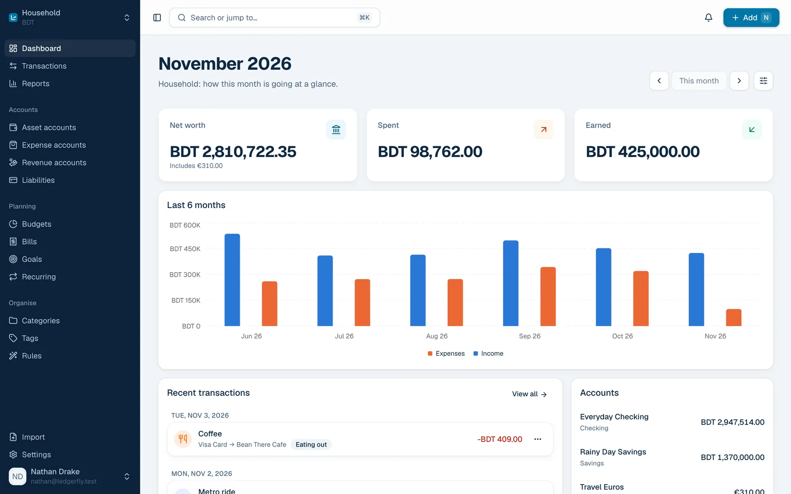
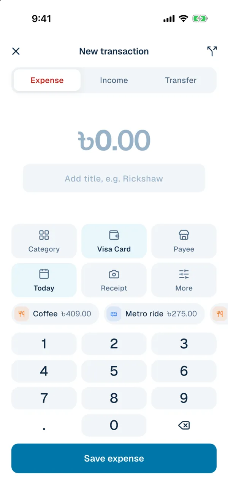
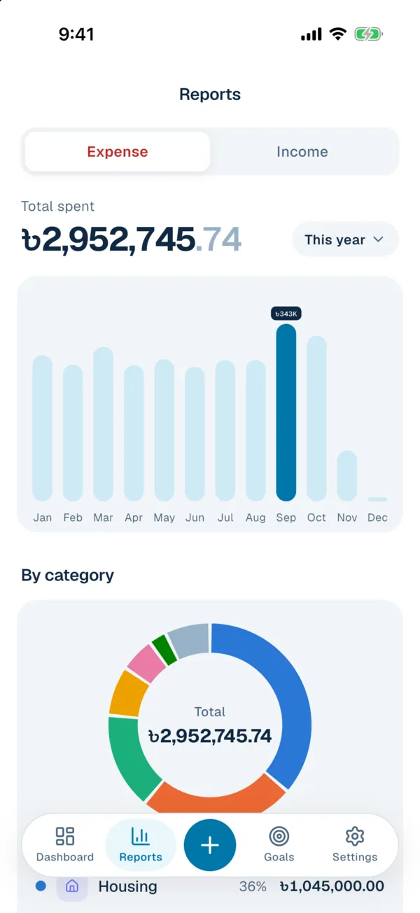
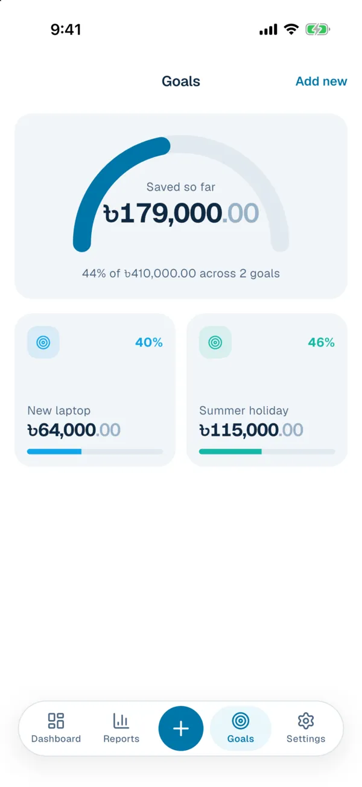

<div align="center">


# LedgerFly

**Self-hosted personal finance. Your money, on your own server.**

Accounts, budgets, bills, goals, investments, rules and reports with real double-entry bookkeeping,<br>
plus a web app and native apps for Android and iOS.

[](https://github.com/nayeemdev/ledgerfly/actions/workflows/api.yml)
[](https://github.com/nayeemdev/ledgerfly/actions/workflows/web.yml)
[](LICENSE)
[](https://ledgerfly.nayeemdev.com)

[Website](https://ledgerfly.nayeemdev.com) · [Self-hosting guide](https://ledgerfly.nayeemdev.com/self-hosting/) · [Mobile apps](https://ledgerfly.nayeemdev.com/apps/) · [Report a bug](https://github.com/nayeemdev/ledgerfly/issues)

<br>



</div>

## Why LedgerFly

- **Your data stays with you.** Everything lives in a database on your server. No accounts with anyone else, no tracking.
- **Real accounting underneath.** Every transaction moves money between two accounts, so balances, reports and reconciliation add up. It is a modern take on [Firefly III](https://www.firefly-iii.org/).
- **Fast to use every day.** Quick add with smart suggestions, a command palette, rules that do the filing and a mobile app with a keypad.
- **Easy to run.** One Docker Compose stack, and every setting that differs between installations is managed from the app, not config files.

## Features

<table>
<tr>
<td width="50%" valign="top">

**Money**
- Checking, savings, cash, credit cards, loans and debts
- Split transactions, transfers and reconciliation
- Multi-currency with scheduled exchange rates
- Receipts and attachments

**Planning**
- Budgets that reset or roll over, with warnings
- Bills and subscriptions with reminders
- Savings goals
- Recurring transactions

**Investments**
- Shares, funds, deposits, savings schemes, gold, property and private investments
- Average cost, valuations, realised gains and income
- Payout schedules with reminders and a return roadmap
- Tax at source, DPS installments, renewals and partner shares
- Yearly return, target mix, income report, what-if calculator and zakat estimate

</td>
<td width="50%" valign="top">

**Automation and insight**
- Rules that set categories, tags and budgets
- Reports: income vs expenses, net worth, categories, tags, payees
- Search with filters and saved searches
- CSV and camt.053 import, JSON backup export, webhooks

**People and alerts**
- Shared ledgers with owner, editor and viewer roles
- Two-factor sign in
- Alerts by email, browser push, [ntfy](https://ntfy.sh) or the mobile app
- Quiet hours and per-alert channel choices

</td>
</tr>
</table>

<div align="center">
&nbsp;&nbsp;
&nbsp;&nbsp;

</div>

## Quick start

You need a Linux server with Docker. The [self-hosting guide](https://ledgerfly.nayeemdev.com/self-hosting/) covers the whole setup, including HTTPS, backups and updates.

```bash
git clone https://github.com/nayeemdev/ledgerfly.git
cd ledgerfly
cp .env.example .env            # set DB_PASSWORD and DB_ROOT_PASSWORD
cp api/.env.example api/.env    # set APP_KEY, APP_URL, APP_ENV=production, APP_DEBUG=false
docker compose up -d --build
docker compose exec api php artisan db:seed --force
```

Create `APP_KEY` with `echo "base64:$(openssl rand -base64 32)"`. The app is served on `http://localhost:8000` (change with `APP_PORT`); put a reverse proxy such as Caddy in front for HTTPS.

**The first account created on a new server becomes its admin.** Sign-ups, outgoing email, exchange rates, alert thresholds and upload limits are then set from the web app under Settings, System.

## Mobile apps

| Platform | Status |
|---|---|
| Android | Coming to Google Play. Build the APK yourself in the meantime. |
| iOS | No App Store release. Build and install it on your own device with Xcode. |

See the [apps page](https://ledgerfly.nayeemdev.com/apps/) for build steps and [mobile/README.md](mobile/README.md) for development.

## Repository layout

| Path | What |
|---|---|
| [`api/`](api) | Laravel 13 API (PHP 8.5), served under `/api/v1` |
| [`web/`](web) | React + Vite single page app, built to static files |
| [`mobile/`](mobile) | Flutter app for iOS and Android |
| [`widgets/`](widgets) | iOS quick entry with Scriptable and Shortcuts |
| [`site/`](site) | The website, a static site with no dependencies |
| [`docker/`](docker) | Images and config for the Compose stack |
| [`docs/`](docs) | Plan and project documentation |

## Development

Requirements: PHP 8.5 with `bcmath`, `intl` and `pdo_mysql`, Composer, Node 24 with pnpm, Docker (for MySQL), and Flutter for the mobile app.

```bash
cp .env.example .env            # set DB_PASSWORD and DB_ROOT_PASSWORD
docker compose up -d mysql
```

<details>
<summary><b>API</b></summary>

```bash
cd api
composer install
cp .env.example .env            # set DB_PASSWORD to the same value as in ../.env
php artisan key:generate
php artisan migrate --seed
php artisan serve
```

Notifications and webhooks are queued. To process them locally, run `php artisan queue:work` in another terminal. API documentation is available at `/docs/api` while `APP_ENV=local`.

To try every feature with a year of realistic data, set `DEMO_PASSWORD` in `api/.env` and run `php artisan db:seed --class=DemoSeeder` on a fresh database. It signs in as `nathan@ledgerfly.test`.

</details>

<details>
<summary><b>Web</b></summary>

```bash
cd web
pnpm install
cp .env.example .env
pnpm dev
```

Vite proxies API requests to `API_PROXY_TARGET`, so open the Vite URL and everything runs on one origin.

</details>

<details>
<summary><b>Mobile</b></summary>

```bash
cd mobile
flutter pub get
flutter run
```

See [mobile/README.md](mobile/README.md) for simulator addresses, widgets and alerts.

</details>

<details>
<summary><b>Website</b></summary>

```bash
cd site
node build.mjs                  # writes the site to site/dist
```

It is deployed as a Cloudflare Worker with static assets: `site` is the root directory, `node build.mjs` the build command and `npx wrangler deploy` the deploy command, which reads `site/wrangler.jsonc`. Set `SITE_URL` to the site's address and, once the apps are published, `PLAY_STORE_URL` and `APP_STORE_URL` to turn the store badges on. Social images are rendered from `site/og/template.html` at 1200×630.

</details>

### Quality checks

```bash
cd api && composer lint && php artisan test
cd web && pnpm lint && pnpm build && pnpm test
cd mobile && flutter analyze && flutter test
```

The API tests use the `ledgerfly_testing` database, which the MySQL container creates on first start.

<details>
<summary><b>Why MySQL and not PostgreSQL?</b></summary>

PostgreSQL would work fine, but MySQL is the practical choice here:

- **Hosting.** MySQL (or MariaDB) is available on practically every host, from shared hosting and cPanel to managed databases and every VPS image. A self-hosted finance app should be easy to run anywhere.
- **Nothing is missing.** Money is stored as exact `DECIMAL(32,12)`, rule and webhook payloads fit JSON columns, and running balances and reports use CTEs and window functions, all supported since MySQL 8.0.
- **Portability.** The code uses Eloquent and the query builder only, with no engine-specific SQL, so MariaDB works as well.

</details>

## Contributing

Bug reports and pull requests are welcome. For anything bigger than a small fix, please [open an issue](https://github.com/nayeemdev/ledgerfly/issues) first so we can agree on the approach. Run the quality checks above before sending a pull request.

## License

LedgerFly is free software under the [GNU Affero General Public License v3.0](LICENSE). You can use, change and host it, and if you offer a modified version to others over a network, you share your changes under the same license.
